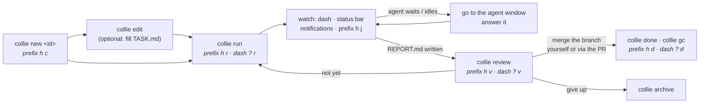
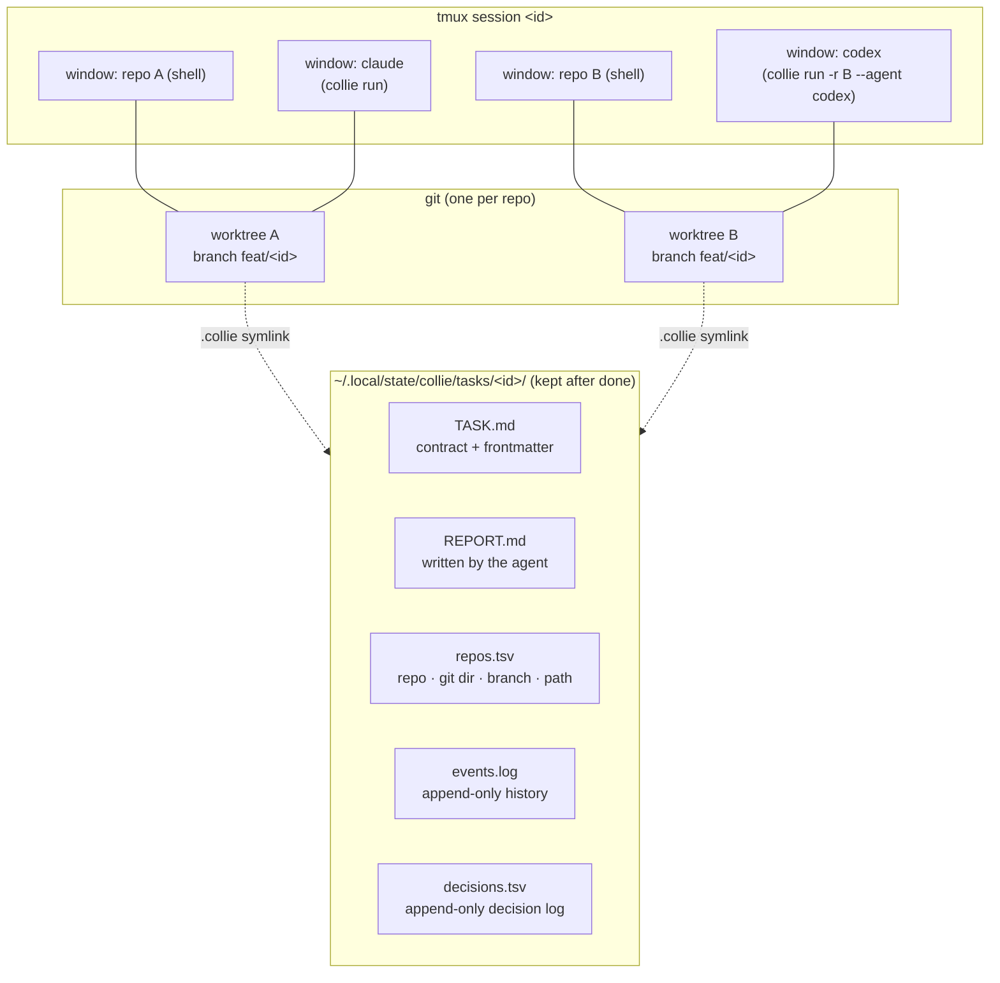
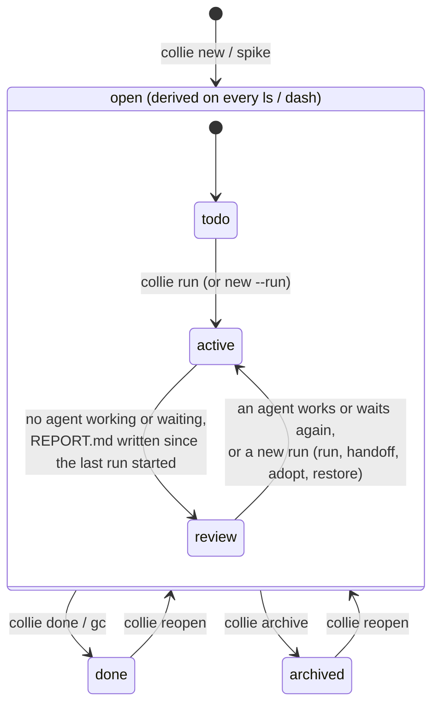
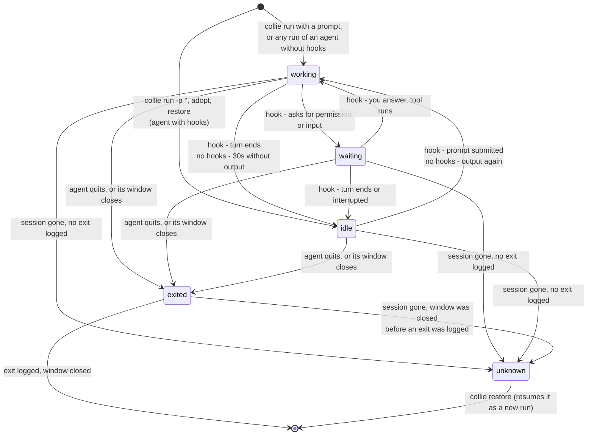
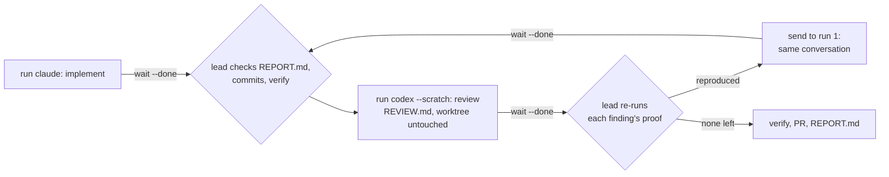

# tmux-collie — Usage at a glance

Diagrams and tables for how a task moves from `collie new` to `done`. The
[README](https://github.com/TSLsun/tmux-collie#readme) has every flag; [DESIGN.md](DESIGN.md) has the reasons.

The dashboard requires fzf 0.73 or newer: earlier releases can drop background action reloads and leave completed tasks in the list.

## 1. The everyday loop



Shortest path for a one-repo change, from inside that repo:

```sh
collie new fix-retry -t fix -m 'retry 5xx on upload'   # worktree + session
collie run fix-retry                                   # agent reads .collie/TASK.md
collie review fix-retry                                # commits, diff stat, REPORT.md
collie verify fix-retry                                # run TASK.md's ## Verify blocks
# merge fix/fix-retry (PR or locally), then:
collie gc                                              # or: collie done fix-retry
collie history                                         # later: finished tasks, their commits and REPORT.md
```

`collie new` without an id (also `prefix h c` and the dashboard's `c`) asks
for each field in turn and checks the id and type as soon as they are typed:
an invalid or taken id is asked again with the reason, and an uppercase one
offers its lowercase (Enter accepts it). For more than a line of objective,
answer `e` to write TASK.md — Objective, Context, Acceptance Criteria — in
`$EDITOR` before the agent starts. If creation still fails, what you typed
is kept in `new-draft` under the state dir and the next `collie new` offers
it as the defaults.

`collie new <id>` prints only the primary worktree path on stdout, so
`cd "$(collie new x)"` works. Without a tty (an agent creating a task), it
adds a short note on stderr: the task belongs to its own agent, the session
that created it fills `.collie/TASK.md` if needed, starts the agent with
`collie run <id>` (or, after `--run`, finds it already running) and stops.

## Comparing independent candidates

`collie race <id> -n N` creates N child tasks (`<id>-1` through `<id>-N`)
with `exp/<id>-<n>` branches from the task branch's same starting commit,
copies the parent TASK.md, and starts one run per candidate. Use `--agent
a,b,c` to assign agents in order (the list cycles); `--model`, `--effort` and
`-p` configure each run. A race uses one git repo, selected with `-r` if
needed; `-n` is 2..9. Each candidate is a normal task, so wait for it
individually with `collie wait <id>-<n> --done`.

`collie review <id>` shows the parent's usual review followed by a candidate
comparison table and each candidate's diff stat and REPORT.md. Review a
candidate directly with `collie review <id>-<n>`.

`collie pick <id> <n>` keeps candidate N's work on the original task branch.
It only fast-forwards when the task worktree is clean and its branch is still
at the race's recorded base. It never resets or creates a merge commit.
Candidate branches are kept; candidate tasks remain available. Archive them
individually when no longer needed, e.g. `collie archive <id>-1`.
## 2. What a task is made of



| Piece | One per | Created by | Removed by | Survives `kill-server`? |
|---|---|---|---|---|
| Task record (`TASK.md`, `repos.tsv`, `events.log`, `REPORT.md`, `decisions.tsv`) | task | `new`, `spike` | never | yes |
| Commit snapshot (`commits.txt`) | task | `done`, `archive` | never | yes |
| Handoff packet (`handoffs/`) | handoff attempt | `handoff` | never | yes |
| Branch `<type>/<id>` | repo in the task | `new`, `add`, `spike` | never (delete it yourself) | yes |
| Worktree + `.collie` symlink | repo in the task | `new`, `add`, `spike` | `done`, `archive`, `gc` | yes |
| tmux session `<id>` | task | `new`, `go` (rebuilds it) | `done`, `archive`, `gc` | no; `go` rebuilds it |
| Shell window | repo in the task | with the session | with the session | no |
| Agent window (a *run*) | `collie run` / `adopt` | `run`, `adopt` | closing the window | no; its run becomes `unknown` until `collie restore` |

## 3. Task status

Status is derived on every `ls` / `dash`; only `done` and `archived` are
stored (in TASK.md's frontmatter).



| Status | Means | You usually |
|---|---|---|
| `todo` | Task exists, no agent run yet | fill TASK.md, then `collie run` |
| `active` | At least one run; no fresh REPORT.md, or an agent is working/waiting | answer waiting agents, otherwise leave it |
| `review` | Agents are quiet and the latest run left a REPORT.md | `collie review`, then merge or `run` again |
| `done` | Accepted: worktrees and session gone, branches and record kept | nothing; `ls -a` still shows it |
| `archived` | Abandoned: same cleanup as `done` | nothing |

`done` / `archive` refuse while a worktree is dirty or a branch has commits
not in its base branch; `--force` overrides both (and discards uncommitted
changes). `gc` runs `done` for every task whose branches all moved past their
start and are merged into base (squash merges count with git >= 2.38), and
skips the rest. A branch must also have commits of its own: one only
fast-forwarded to base, or with base merged into it, is reported as
`skipped <id>: no own commits on <repo>`. A fast-forward merge is recognised
from the branch's reflog or a merged PR. Merged tasks whose agent is working
or waiting are skipped too (`skipped <id>: agent waiting`); finish those with
`collie done`.

Each worktree they remove or skip is listed with a bucket and its size
(`du -sk`), then the total reclaimed:

| Bucket | Meaning | `done` | `archive` |
|---|---|---|---|
| `wip:N` | N tracked files with uncommitted edits | refuses | refuses |
| `scratch:N` | N untracked files that are not ignored | refuses | refuses |
| `unmerged` | branch has commits not in base | refuses | removes (branch kept) |
| `clean` | none of the above | removes | removes |

```text
$ collie gc -n
fix-retry
  A  clean  1.2M
docs-tweak
  A  scratch:1  48K
would reclaim 1.2M (wip/scratch are skipped)
```

`--force` removes every bucket. The report changes nothing: `gc` removes
exactly what `done` would.

### Task dependencies

A task can name the tasks it builds on in TASK.md's `after:` field:

```sh
collie new lead --after "run-primitives collie-send"
collie set lead after="run-primitives collie-send"   # replace; after= clears
```

While a `todo` task has an unsatisfied dep, `ls` shows `blocked:<ids>` and the
dashboard `blocked` (sorted after `start`). Only cached data is read (task
status and the dashboard's PR cache), so rows stay fast:

| Dep | Counts as |
|---|---|
| status `done` | satisfied |
| each repo with a cached PR has a `merged` one (squash merges too) | satisfied |
| branch merged without a PR | satisfied once `collie gc` marks it done |
| `archived`, or no such task | broken: blocks (`✗` in the preview) |
| anything else | waiting: blocks (`·`, with its status and PRs) |

Active and review tasks are never shown as blocked. Cycles and unknown ids
warn in `set` / `new` and never break `ls` or the dashboard; the preview flags
a cycle. The preview (and `show`) lists each dep and `blocks:`, the open tasks
waiting on this one. `collie run` on a blocked task asks `run anyway? (y/n)`
on a terminal and warns otherwise; dashboard `r` asks y/n first.

## 4. Agent state (per run)



| State | Notifies? | Source |
|---|---|---|
| `waiting` | yes | hook (not available for generic agents) |
| `idle` | yes, from `working`, once it holds `@collie-idle-grace` s (3) | hook; generic agents: 30s without output |
| `working` | no | hook; generic agents: output |
| `exited` | no | wrapper saw the process exit |
| `unknown` | no | window or session gone |

The idle notification waits `@collie-idle-grace` seconds (3) and is dropped
when the state changed meanwhile: Claude may resume on its own right after its
turn ends (a background task's result). The state
itself, `collie wait` and the status bar follow the hooks at once. omp's
task-tool subagents do not report state; only the main session does.

For an opt-in indicator in each window tab, include `#{collie_window}` in
`window-status-format` and/or `window-status-current-format` before loading
the plugin:

```tmux
set -g window-status-format '#I:#W #{collie_window}'
set -g window-status-current-format '#I:#W #{collie_window}'
```

It reads the window's `@collie_state` directly: red `●` for waiting, yellow
for idle, green for working, and nothing for other windows. It preserves the
surrounding window style and adds no shell calls on redraw. Without the
placeholder, window formats are unchanged.

A task's `agent` column shows its most urgent run (`waiting` > `idle` >
`working` > `exited` > `unknown`). Status and agent fold into one *needs*
value (`ls`'s last column, the dashboard's STATE), first match:

| Needs | When | Dash glyph |
|---|---|---|
| `answer` | an agent is `waiting` | red `●` |
| `findings` | REVIEW.md has open findings ([format](#review-findings)), no agent working | red `●` |
| `review` | task status `review` | red `●` |
| `reply` | an agent is `idle` (turn over, no fresh REPORT.md) | red `●` |
| `-` | an agent is `working` (dash: `working`), or task finished | yellow `◐` |
| `start` | task status `todo` | dim `○` |
| `blocked:<ids>` | task status `todo`, its `after:` tasks unsatisfied (dash: `blocked`) | dim `○` |
| `stalled` | `active`, but no live agent | red `●` |

The dashboard sorts tasks in that urgency (`answer` > `reply` > `findings` >
`review` > `stalled` > `working` > `start` > `blocked`), then priority, and shows them in groups
(needs you, active, todo); `tab` /
`shift-tab` regroup by priority or repo.

The dashboard caches PRs per repository for five minutes. It lists up to 1,000
PRs on the task branch and cross-branch PRs whose body explicitly says
`Restore ... from #N` on one line, where `#N` is a task-branch PR. Other
references (including reverts and dependencies) are not proof of ownership.
This conservative rule can miss differently worded restorations. A failed
repository lookup keeps its previous cached PRs. The row abbreviates long PR
lists with `+N`; the preview and `dash -n` show the complete cached list.

`collie brief` is the short form: a block per task that needs you, in the
same order, with separate reason, PR details and next command. It reads only
local state and the dashboard's PR cache, so it never touches the network.
`collie todo` (`prefix h i`, a popup) lists the same rows in fzf. `enter`
acts on a row: an agent row goes to its agent window, review and findings
show `collie review` in a pager (`q` returns to the list), stalled goes to
the task session, a lost run runs `collie restore`, ci runs
`collie ci <id> --send`. The preview shows the agent's screen or the review.
`ctrl-a` lists every open task, to find one by name; `ctrl-t` goes back.

`collie next` (`prefix h n`) switches to the next task in that order after
the one you are in, wrapping around, with one stop per task: an agent row
to its agent window, others to the task session. Nothing is stored, so a
row you leave unresolved comes round again. `prefix h l` returns to the
session you came from.

```text
answer  login (P1)
  Why: an agent waits for your answer
  Next: collie go login

review  deploy-v2 (P2)
  Why: Added blue/green deploy.
  PR: https://github.com/o/r/pull/12 (open, CI pass)
  Next: collie review deploy-v2

stalled  cache (P2)
  Why: its agents were lost with the tmux server
  Next: collie restore cache
```
Agents get hooks per run, nothing installed: claude, codex, gemini, omp.
Any other command (`--agent aider`) runs without hooks. Agents you start by
hand in a task's session are detected by process (working/idle only, no
notifications); `collie adopt` restarts a hand-started claude, codex or omp under
`collie run` with its conversation resumed. `collie restore` restarts the
runs lost with a dead tmux server (claude, codex and omp by logged session ID;
omp falls back to the worktree's latest conversation when no ID was logged).
Agents started by hand are not recorded, so they are not restored.

`--model` and `--effort` pick a run's model and reasoning effort (claude
`--model`/`--effort`, codex `-m`/`-c model_reasoning_effort`, omp
`--model`/`--thinking`); other agents refuse them. Without `--model`, omp
uses its own configured default.

### Reading a run's screen

`collie peek [<id>] [--run N | -r repo] [-n lines]` prints the last 40
lines of a live pane by default, joining wrapped lines and dropping trailing
blank lines. It works in any run state and does not switch windows, log an
event, or store the screen (which may contain secrets). As with `send`,
multiple live runs require a selection. The task menu's `p` popup displays
the screen or the selection guidance; `-n` accepts up to 100000 lines.
Exit codes: `0` printed, `3` no live pane, `1` other errors. The dashboard run
preview also shows the tail of a
live pane.

### Waiting for a run

A script or coordinating agent can block on a run instead of watching it:

```sh
collie wait fix-retry --state idle               # latest run stopped working
collie wait fix-retry --run 2 --done --timeout 3600
```

`--state` waits for `working`, `idle` (default), `waiting` or `exited`.
`--done` waits for the run's done signal: the agent runs `collie signal done`
in its window when its turn's work is complete (`$COLLIE_TASK`/`$COLLIE_RUN`
are set for every run), and `wait` returns once the run has also stopped
working. A signal counts until `collie send` prompts the run again (its
`sent` event); a run restarted by `collie restore` keeps its signal and is followed
by `--run` under its old number. Exit codes: `0` reached, `1` timeout, `2`
cannot happen any more (the run is gone; for `--done`, without signalling).

For Codex setup and limitations, see [Agent details](https://github.com/TSLsun/tmux-collie#agent-details).

### Cross-agent handoff

To continue a Claude, Codex, or omp run with a different one of those agents,
choose the source run from `collie show` and write a nonempty note with
completed work, decisions, verification, unresolved issues, and the next action:

```sh
collie show fix-retry
collie handoff fix-retry --from 1 --agent omp --note handoff.md
```

The destination starts a fresh conversation in a separate run/window using
the source repository; `-r <repo>` selects another repository in the same task.
Existing worktrees, source runs, and conversation IDs are preserved. The source
agent stays running: pause or stop its work yourself before handing off if
concurrent edits could conflict. Handoff does not merge branches.

The command prints a unique directory under the task record's `handoffs/`.
It contains `HANDOFF.md`, `NOTE.md`, a `TASK.md` snapshot, and `REPORT.md` when
present. These snapshots are read-only to prevent accidental edits and remain
unchanged when later runs update the task or report. The current TASK.md stays
authoritative. No private transcript or resume ID is passed between agents.
Successful handoffs record a source/destination link in `events.log`; a failed
launch keeps its packet for diagnosis without recording a successful handoff.

### Decision log

An agent records each decision worth resuming from with `collie log`; the
task comes from `$COLLIE_TASK`:

```sh
collie log build 'header via ln' 'atomic under races' test/log.bats ok
```

The row goes to `decisions.tsv` in the task record (`.collie/decisions.tsv`),
created with a header on first use:

| Column | Value |
|---|---|
| `ts` | UTC time, stamped |
| `run` | the agent window's run number, stamped (`-` outside one) |
| `phase` `decision` `why` `evidence` `result` | the five arguments |

Tabs and newlines in a cell become spaces, and a cell starting with `=` `+`
`-` or `@` gets a `'` prefix so spreadsheets don't run it. The file is
append-only and never committed: correct a row by logging a new one.
`collie show` and the dashboard preview print the last row, and
`collie history` searches the file. The default run prompt points agents at
`collie log`; when and what to log is up to the team's workflow.

### Progress notes

At phase changes—such as finishing a slice, hitting a blocker, or moving from
implementation to verification—an agent can record one short checkpoint:

```sh
collie note 'retry fix implemented; starting verification'
collie note -t fix-retry 'blocked on the upstream API decision'
collie note                       # print the latest note and its age
```

With no explicit task id, the command uses `$COLLIE_TASK`; `-t` selects a task
from outside its session. Arguments are joined into one line, sanitized, and
capped at 200 characters. The latest note appears in `collie show` and the
dashboard preview. Notes are display-only: they are never included in agent
prompts. The default run prompt asks agents to leave a note at phase changes;
if the command fails, they should continue their work.


### Leading a task with an agent

The [`collie-lead`](https://github.com/TSLsun/tmux-collie/blob/main/skills/collie-lead/SKILL.md) skill makes the agent that
runs it the lead of one task: it does not write the code itself, it drives
other runs with collie commands and checks their work.

```sh
npx skills add TSLsun/tmux-collie     # installs skills/collie-lead
```



| Step | Commands | The lead checks itself |
|---|---|---|
| implement | `run --agent claude -p ...`, `wait --run N --done` | REPORT.md is new, commits in `review`, clean tree, `verify` passes |
| review | `run --agent codex --scratch -p ...`, `wait --run R --done` | REVIEW.md is new; the task worktree's HEAD and `git status` unchanged |
| fix | `send --run N -f findings.md`, `wait --run N --done` | each sent finding was reproduced by its command; it no longer reproduces |
| ship | `verify`, then TASK.md `## Ship` | `verify` passes on the final HEAD |

Every prompt tells the agent to finish its turn with `collie signal done`.
`send` clears that signal, so `wait --done` after a `send` waits for the new
turn, never for the previous one. Each decision goes to `collie log`
(`.collie/decisions.tsv`); with `events.log` that is all a fresh lead needs to
resume. The lead stops for you when the contract is unclear, a decision is
hard to reverse, two fix rounds do not converge, or CI fails without a proven
cause; `collie brief` lists it.

The reviewer runs with `--scratch`: its own worktree, detached at the task
branch's head next to the task worktree (`<worktree>.scratch-<n>`, with the
same `.collie` link), so it can build and run repros without touching the
implementer's files. For a re-review it checks out the new head there
(`git checkout --detach <branch>`). Scratch runs do not count as the
implementer's last run for the task status, and `restore` skips them. `done`
and `archive` remove scratch worktrees with whatever they hold; `gc -n` lists
them.

#### Review findings

The needs column shows `findings` while `.collie/REVIEW.md` is newer than
`.collie/REPORT.md` (the implementer's last turn) and has an open finding: a
line starting with `- [ ] ` (a Markdown task item). Tick it (`- [x]`) or
delete it once it is resolved or rejected; a REVIEW.md without unticked
items (for example "no findings") has none. Collie only reads the marker;
what counts as a finding is up to the reviewer and the lead.

```markdown
- [ ] lib/a.sh:12 trim clobbers the caller's `_t`. Proof: `sh probe.sh` -> `_t after trim: [x]`
- [x] test/a.bats:3 missing check for empty input (fixed in 8391040)
```

The lead needs the tmux socket, so run it in claude (or any agent without a
socket-blocking sandbox). Codex's workspace-write sandbox blocks the tmux
socket, so a lead cannot drive collie there. A run's `collie signal done` and
`collie note` use the same task-event logging path without controlling tmux;
they remain callable from the agent run (using the collie executable provided
to the run), though sandbox filesystem policy can still deny writes to task
state outside permitted locations.

## 5. Where each action lives

| Action | CLI | `prefix h` menu | Dashboard (`prefix h h`) |
|---|---|---|---|
| Dashboard | `collie dash` | `h` | — |
| What waits on you | `collie brief`, `collie todo` | `i` (to-do popup) | sorted task list |
| Next task that waits on you | `collie next` | `n` | — |
| New task | `collie new` | `c` (prompts, switches to it) | `?` `c` |
| Edit TASK.md | `collie edit` | `e` | `e` or `?` `e` |
| Run agent | `collie run --agent` | `r` (menu of agents, default first) | `r` or `?` `r` (digit picks, `enter` the default) |
| Run default agent | `collie run` | `R` | `R` or `?` `R` |
| Continue with another agent | `collie handoff` | — | `u`, then `h` on the run (note in `$EDITOR`) |
| Type into an idle agent | `collie send` | — | — |
| Read an agent screen without switching | `collie peek` | `p` (task session popup) | run preview |
| Failing CI logs, optionally sent to the agent | `collie ci` | — | — |
| Pause an idle agent (leaves RESUME.md) | `collie pause` | — | — |
| Adopt hand-started agent | `collie adopt` | `a` | `?` `a` |
| Restore agents after the server died | `collie restore` | — | — |
| Wait for a run's state or done signal | `collie wait` | — | — |
| Go to task | `collie go` | — | `enter` (most urgent agent window) |
| Runs of a task | `collie show` | — | `u` (`enter`: its window, `esc`: back) |
| Jump to last alert | — | `j` | — |
| Back to the last session | — | `l` | — |
| Review | `collie review` | `v` | `v` or `?` `v` |
| Run TASK.md Verify blocks | `collie verify` | — | — (last result in the preview) |
| Shell in worktree | — | `t` (popup at the pane's path) | `?` `t` (task's first worktree) |
| lazygit | — | `g` | — |
| Done | `collie done` | `d` (confirms) | `d` or `?` `d` (confirms) |
| Archive | `collie archive` | `x` (confirms) | `?` `x` (confirms) |
| Sync task branch with base | `collie sync` | `s` (confirms, shows output) | `?` `s` (confirms, `space` marks several) |
| Finish merged tasks | `collie gc` | `G` (lists them, confirms) | — |
| Show details | `collie show` | — | preview pane (Objective) |
| Log a progress note | `collie note` | — | preview pane (latest note) |
| Log a decision | `collie log` | — | preview pane (last decision) |
| Group by status / priority / repo | — | — | `tab` / `shift-tab` |
| Priority / title | `collie set` | — | — |
| Task dependencies | `collie set <id> after=…`, `new --after` | — | preview (`after:`, `blocks:`) |
| Extra repo mid-task | `collie add` | — | — |
| Switch an attached repo's branch | `collie add <id> -r repo:branch` | — | — |
| Remove repos, keeping their branches | `collie drop <id> -r repo... [--force]` | — | — |
| Branch off dirty work | `collie spike` | — | — |

The menu's task entries (`r a e v d x s`) appear only inside a task's session,
with the same keys and labels as the dashboard's `?` actions. `t` differs on
purpose: the menu opens the shell at the current pane's path (it works in any
session), the dashboard, which has no pane of the task, in its first worktree.
On the dashboard an action key acts on the selected row at once; `/` starts a
filter, in which every key types; `?` lists every action.
`<id>` may be omitted anywhere inside a task session (`$COLLIE_TASK`).

## 6. Variations

| You want | Use |
|---|---|
| Several repos in one task | `collie new <id> -r api -r web`, or `-w <workspace>` |
| A different branch per repo | `-r api:release/v2` |
| Add a repo later | `collie add <id> -r infra` |
| Switch an attached repo to another branch | `collie add <id> -r infra:release/v2` (keeps the old branch; mixes with new `-r`, all-or-nothing) |
| Remove a repo | `collie drop <id> -r infra` (refuses dirty/unmerged worktrees, active agents, cwd inside, or last repo; `--force` skips dirty/unmerged checks) |
| A second agent on the same task | `collie run <id> --agent codex [-r repo]` (one window per run) |
| Continue another agent's work with explicit context | `collie handoff <id> --from <run> --agent <claude\|codex\|omp> --note <file>` |
| Send a follow-up, fix or pause request to a running agent | `collie send <id> [--run N] [--wait] <text>` or `-f <file>` (refuses while it works: exit 2) |
| Read a running agent's screen | `collie peek <id> [--run N \| -r repo] [-n lines]` |
| Give an agent its failing CI | `collie ci <id> [--lines N]` prints failing checks and log tails (exit 0 none failing, 2 pending, 3 failing, 1 errors); `--send [--run N] [--wait]` writes `.collie/CI.md` and prompts the run through `collie send`. Cancelled or timed-out checks only print the `gh run rerun` command |
| Pause an agent and pick up later | `collie pause <id> [--run N] [-p <request>]`: it writes `.collie/RESUME.md`, which `show` and the preview mention and the next `run`, `handoff` or `adopt` reads |
| The agent to push, open a PR and watch CI | `collie new --ship` or `set -g @collie-ship on` |
| Move uncommitted experiments out of the way | `collie spike <id>` inside the worktree (new `exp/<id>` task, tracked changes only) |
| Keep `exp/*` off the remote | link `hooks/pre-push` (see README) |

### Several repos in one task

A task holds one worktree and branch per repo (one `repos.tsv` row each) and
expects one PR per repo. `TASK.md`, `REPORT.md` and the rest of the record are
shared: every worktree's `.collie` links to the same task dir, and
`.collie/repos/<name>` links to each worktree.

| Command | With several repos |
|---|---|
| `new -r a -r b`, `-w`, `add`, `drop` | all-or-nothing per call; `drop` refuses to remove the last repo |
| `run` | the agent starts in the first repo (`-r` picks another); claude, codex, gemini and omp also get the other worktrees and the task dir |
| `ls`, `show` | repo names; `show` lists each branch and path |
| dash row | the task's PR numbers by state color, without repo names (up to about 24 columns, then `+N`) |
| dash preview | per repo: branch, cached PRs with state and CI, ahead/dirty counts, diff stat |
| `brief` | PRs read `repo#N` once a task has PRs in more than one repo |
| `review` | a section per repo: commits ahead (marked `no commits` or `merged`), cached PRs with state and CI, diff stat, dirty files |
| `verify` | every block runs in every worktree; a block opened with ` ```sh repo=<name> ` runs in that repo only; `-r` limits the run to one repo |
| `ci` | the open PRs of every repo; `--send` puts them in one `CI.md` and one prompt |
| `sync` | each repo against its own base, one line per repo; conflicts in several repos reach the agent in one message (or one new run); exits 0 whatever the lines report |
| `gc` | finishes a task once at least one repo landed commits of its own and every other repo is merged or untouched; a partly merged task prints `skipped <id>: merged: a; not merged: b (PR #4 open)` |
| `done` | refuses while any repo is dirty or unmerged, listing each one |
| `archive`, `reopen` | remove, and restore, every worktree; `reopen` is all-or-nothing |
| `after:` | a dependency counts as merged when every repo with a PR has a merged one |

Limits that stay:

- One shared `TASK.md` and `REPORT.md`, so an agent working one repo reads
  the whole task's contract.
- `sync` exits 0 even when a repo's merge failed or a conflict had no
  agent; read its lines.
- `race` races one repo (the first, or `-r`).
- PR state and CI come from the cache the dashboard refreshes (every 5
  minutes, inline in `sync` and `gc`); `brief`, `review` and the preview
  never call `gh`.

