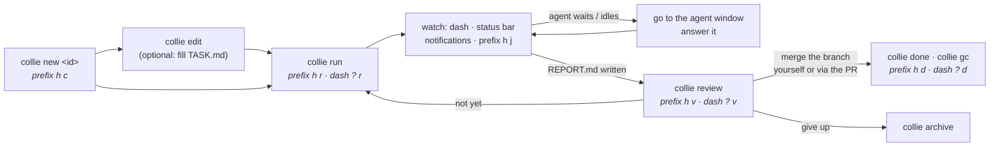
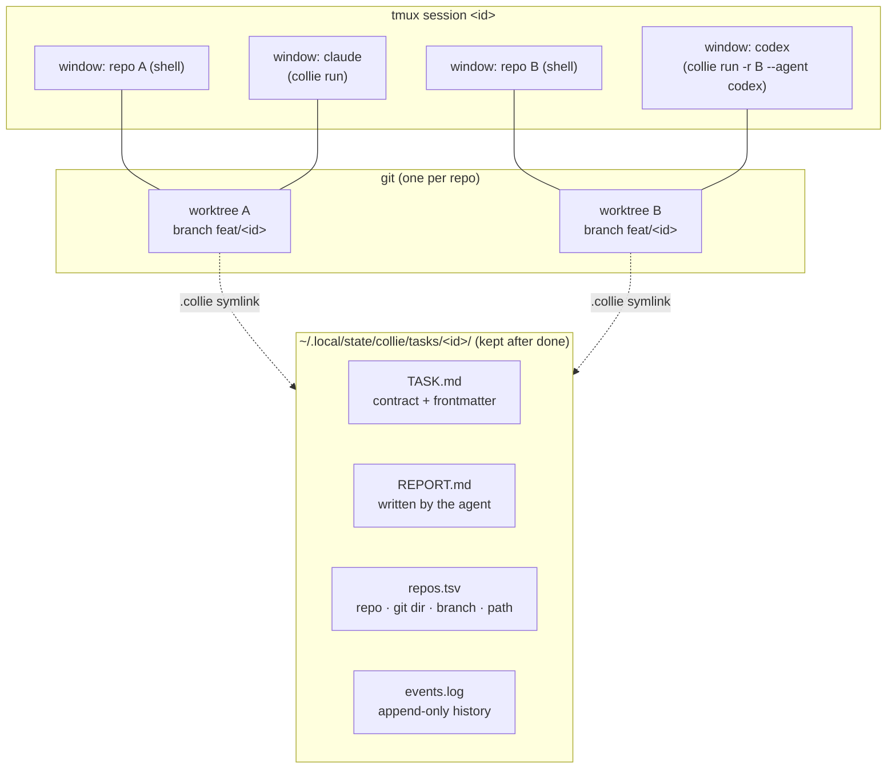
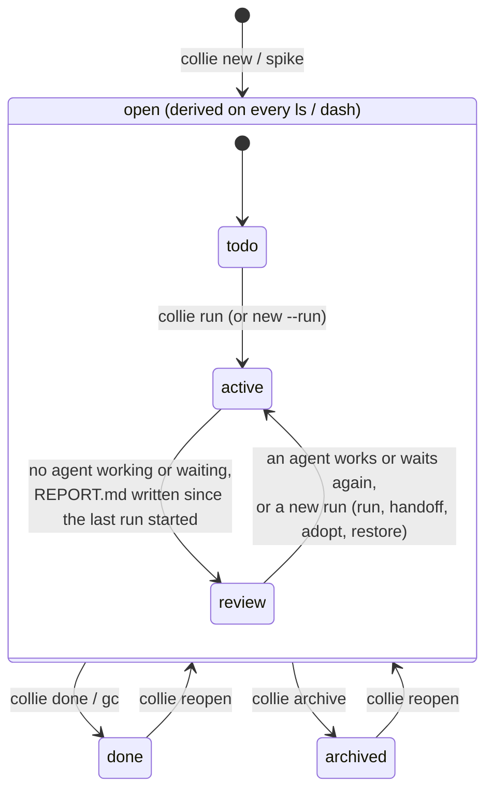
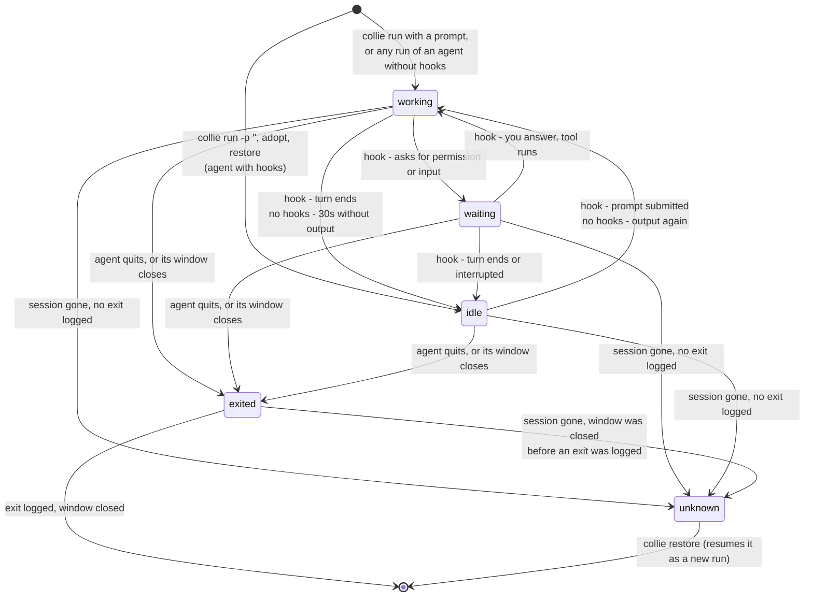

# tmux-collie — Usage at a glance

Diagrams and tables for how a task moves from `collie new` to `done`. The
[README](https://github.com/TSLsun/tmux-collie#readme) has every flag; [DESIGN.md](DESIGN.md) has the reasons.

The dashboard requires fzf 0.73 or newer: earlier releases can drop background action reloads and leave completed tasks in the list.

## 1. The everyday loop



Shortest path for a one-repo change, from inside that repo:

```sh
collie new fix-retry -t fix -m 'retry 5xx on upload'   # worktree + session
collie run fix-retry                                   # agent reads .collie/TASK.md
collie review fix-retry                                # commits, diff stat, REPORT.md
# merge fix/fix-retry (PR or locally), then:
collie gc                                              # or: collie done fix-retry
collie history                                         # later: finished tasks, their commits and REPORT.md
```

## 2. What a task is made of



| Piece | One per | Created by | Removed by | Survives `kill-server`? |
|---|---|---|---|---|
| Task record (`TASK.md`, `repos.tsv`, `events.log`, `REPORT.md`) | task | `new`, `spike` | never | yes |
| Commit snapshot (`commits.txt`) | task | `done`, `archive` | never | yes |
| Handoff packet (`handoffs/`) | handoff attempt | `handoff` | never | yes |
| Branch `<type>/<id>` | repo in the task | `new`, `add`, `spike` | never (delete it yourself) | yes |
| Worktree + `.collie` symlink | repo in the task | `new`, `add`, `spike` | `done`, `archive`, `gc` | yes |
| tmux session `<id>` | task | `new`, `go` (rebuilds it) | `done`, `archive`, `gc` | no; `go` rebuilds it |
| Shell window | repo in the task | with the session | with the session | no |
| Agent window (a *run*) | `collie run` / `adopt` | `run`, `adopt` | closing the window | no; its run becomes `unknown` until `collie restore` |

## 3. Task status

Status is derived on every `ls` / `dash`; only `done` and `archived` are
stored (in TASK.md's frontmatter).



| Status | Means | You usually |
|---|---|---|
| `todo` | Task exists, no agent run yet | fill TASK.md, then `collie run` |
| `active` | At least one run; no fresh REPORT.md, or an agent is working/waiting | answer waiting agents, otherwise leave it |
| `review` | Agents are quiet and the latest run left a REPORT.md | `collie review`, then merge or `run` again |
| `done` | Accepted: worktrees and session gone, branches and record kept | nothing; `ls -a` still shows it |
| `archived` | Abandoned: same cleanup as `done` | nothing |

`done` / `archive` refuse while a worktree is dirty or a branch has commits
not in its base branch; `--force` overrides both (and discards uncommitted
changes). `gc` runs `done` for every task whose branches all moved past their
start and are merged into base (squash merges count with git >= 2.38), and
skips the rest.

Each worktree they remove or skip is listed with a bucket and its size
(`du -sk`), then the total reclaimed:

| Bucket | Meaning | `done` | `archive` |
|---|---|---|---|
| `wip:N` | N tracked files with uncommitted edits | refuses | refuses |
| `scratch:N` | N untracked files that are not ignored | refuses | refuses |
| `unmerged` | branch has commits not in base | refuses | removes (branch kept) |
| `clean` | none of the above | removes | removes |

```text
$ collie gc -n
fix-retry
  A  clean  1.2M
docs-tweak
  A  scratch:1  48K
would reclaim 1.2M (wip/scratch are skipped)
```

`--force` removes every bucket. The report changes nothing: `gc` removes
exactly what `done` would.

## 4. Agent state (per run)



| State | Notifies? | Source |
|---|---|---|
| `waiting` | yes | hook (not available for generic agents) |
| `idle` | yes, from `working` | hook; generic agents: 30s without output |
| `working` | no | hook; generic agents: output |
| `exited` | no | wrapper saw the process exit |
| `unknown` | no | window or session gone |

A task's `agent` column shows its most urgent run (`waiting` > `idle` >
`working` > `exited` > `unknown`). Status and agent fold into one *needs*
value (`ls`'s last column, the dashboard's STATE), first match:

| Needs | When | Dash glyph |
|---|---|---|
| `answer` | an agent is `waiting` | red `●` |
| `review` | task status `review` | red `●` |
| `reply` | an agent is `idle` (turn over, no fresh REPORT.md) | red `●` |
| `-` | an agent is `working` (dash: `working`), or task finished | yellow `◐` |
| `start` | task status `todo` | dim `○` |
| `stalled` | `active`, but no live agent | red `●` |

The dashboard sorts tasks in that urgency (`answer` > `reply` > `review` >
`stalled` > `working` > `start`), then priority, and shows them in groups
(needs you, active, todo); `tab` /
`shift-tab` regroup by priority or repo.

Agents get hooks per run, nothing installed: claude, codex, gemini, omp.
Any other command (`--agent aider`) runs without hooks. Agents you start by
hand in a task's session are detected by process (working/idle only, no
notifications); `collie adopt` restarts a hand-started claude, codex or omp under
`collie run` with its conversation resumed. `collie restore` restarts the
runs lost with a dead tmux server (claude and codex by their logged session id, omp by
the worktree's latest conversation); agents started by hand are not
recorded, so they are not restored.

`--model` and `--effort` pick a run's model and reasoning effort (claude
`--model`/`--effort`, codex `-m`/`-c model_reasoning_effort`); other agents
refuse them.

### Waiting for a run

A script or coordinating agent can block on a run instead of watching it:

```sh
collie wait fix-retry --state idle               # latest run stopped working
collie wait fix-retry --run 2 --done --timeout 3600
```

`--state` waits for `working`, `idle` (default), `waiting` or `exited`.
`--done` waits for the run's done signal: the agent runs `collie signal done`
in its window when its turn's work is complete (`$COLLIE_TASK`/`$COLLIE_RUN`
are set for every run), and `wait` returns once the run has also stopped
working. A signal counts until `collie send` prompts the run again (its
`sent` event); a run restarted by `collie restore` keeps its signal and is followed
by `--run` under its old number. Exit codes: `0` reached, `1` timeout, `2`
cannot happen any more (the run is gone; for `--done`, without signalling).

For Codex setup and limitations, see [Agent details](https://github.com/TSLsun/tmux-collie#agent-details).

### Cross-agent handoff

To continue Claude work with Codex, or vice versa, choose the source run from
`collie show` and write a nonempty note with completed work, decisions,
verification, unresolved issues, and the next action:

```sh
collie show fix-retry
collie handoff fix-retry --from 1 --agent codex --note handoff.md
```

The destination starts a fresh conversation in a separate run/window using
the source repository; `-r <repo>` selects another repository in the same task.
Existing worktrees, source runs, and conversation IDs are preserved. The source
agent stays running: pause or stop its work yourself before handing off if
concurrent edits could conflict. Handoff does not merge branches.

The command prints a unique directory under the task record's `handoffs/`.
It contains `HANDOFF.md`, `NOTE.md`, a `TASK.md` snapshot, and `REPORT.md` when
present. These snapshots are read-only to prevent accidental edits and remain
unchanged when later runs update the task or report. The current TASK.md stays
authoritative. No private transcript or resume ID is passed between agents.
Successful handoffs record a source/destination link in `events.log`; a failed
launch keeps its packet for diagnosis without recording a successful handoff.

## 5. Where each action lives

| Action | CLI | `prefix h` menu | Dashboard (`prefix h h`) |
|---|---|---|---|
| Dashboard | `collie dash` | `h` | — |
| New task | `collie new` | `c` (prompts, switches to it) | `?` `c` |
| Edit TASK.md | `collie edit` | `e` | `ctrl-e` or `?` `e` |
| Run agent | `collie run` | `r` | `ctrl-r` or `?` `r` |
| Continue with another agent | `collie handoff` | — | `u`, then `h` on the run (note in `$EDITOR`) |
| Type into an idle agent | `collie send` | — | — |
| Pause an idle agent (leaves RESUME.md) | `collie pause` | — | — |
| Adopt hand-started agent | `collie adopt` | `a` | `?` `a` |
| Restore agents after the server died | `collie restore` | — | — |
| Wait for a run's state or done signal | `collie wait` | — | — |
| Go to task | `collie go` | — | `enter` (most urgent agent window) |
| Runs of a task | `collie show` | — | `u` (`enter`: its window, `esc`: back) |
| Jump to last alert | — | `j` | — |
| Review | `collie review` | `v` | `ctrl-v` or `?` `v` |
| Shell in worktree | — | `t` (popup) | `?` `t` |
| lazygit | — | `g` | — |
| Done | `collie done` | `d` (confirms) | `ctrl-d` or `?` `d` (confirms) |
| Archive | `collie archive` | `x` (confirms) | `?` `x` (confirms) |
| Finish merged tasks | `collie gc` | `G` (lists them, confirms) | — |
| Show details | `collie show` | — | preview pane (Objective) |
| Group by status / priority / repo | — | — | `tab` / `shift-tab` |
| Priority / title | `collie set` | — | — |
| Extra repo mid-task | `collie add` | — | — |
| Branch off dirty work | `collie spike` | — | — |

The menu's task entries (`e v r a d x`) appear only inside a task's session.
On the dashboard the `ctrl-` keys act on the selected row at once, so plain
keys keep filtering; `?` lists every action.
`<id>` may be omitted anywhere inside a task session (`$COLLIE_TASK`).

## 6. Variations

| You want | Use |
|---|---|
| Several repos in one task | `collie new <id> -r api -r web`, or `-w <workspace>` |
| A different branch per repo | `-r api:release/v2` |
| Add a repo later | `collie add <id> -r infra` |
| A second agent on the same task | `collie run <id> --agent codex [-r repo]` (one window per run) |
| Continue another agent's work with explicit context | `collie handoff <id> --from <run> --agent <claude\|codex> --note <file>` |
| Send a follow-up, fix or pause request to a running agent | `collie send <id> [--run N] [--wait] <text>` or `-f <file>` (refuses while it works: exit 2) |
| Pause an agent and pick up later | `collie pause <id> [--run N] [-p <request>]`: it writes `.collie/RESUME.md`, which `show` and the preview mention and the next `run`, `handoff` or `adopt` reads |
| The agent to push, open a PR and watch CI | `collie new --ship` or `set -g @collie-ship on` |
| Move uncommitted experiments out of the way | `collie spike <id>` inside the worktree (new `exp/<id>` task, tracked changes only) |
| Keep `exp/*` off the remote | link `hooks/pre-push` (see README) |
