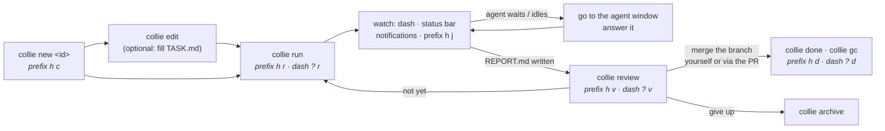
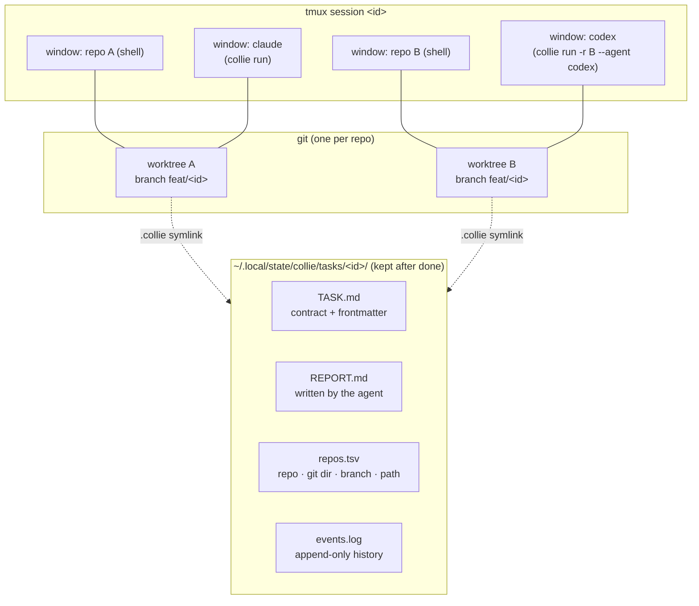
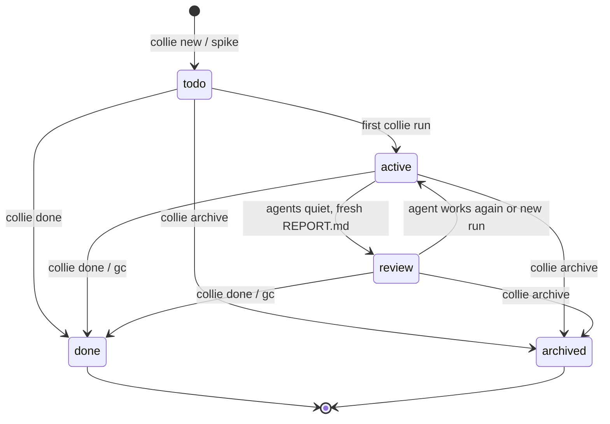
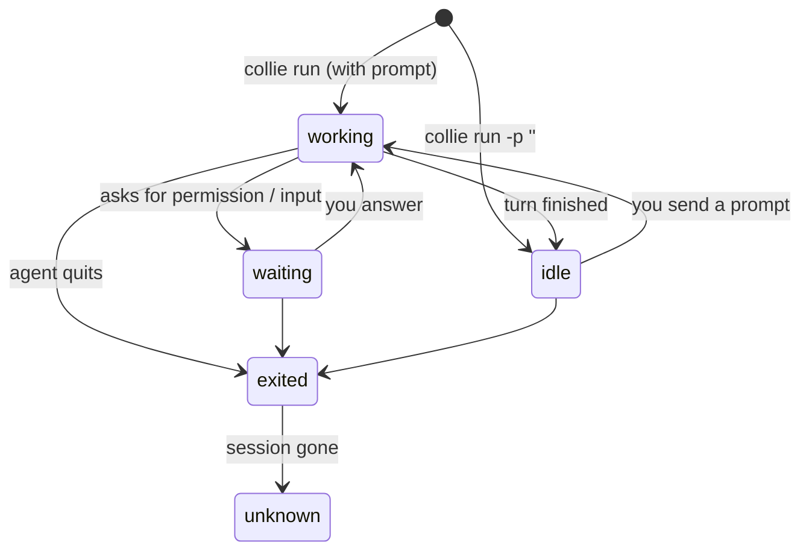

# tmux-collie — Usage at a glance

Diagrams and tables for how a task moves from `collie new` to `done`. The
[README](../README.md) has every flag; [DESIGN.md](DESIGN.md) has the reasons.

## 1. The everyday loop



Shortest path for a one-repo change, from inside that repo:

```sh
collie new fix-retry -t fix -m 'retry 5xx on upload'   # worktree + session
collie run fix-retry                                   # agent reads .collie/TASK.md
collie review fix-retry                                # commits, diff stat, REPORT.md
# merge fix/fix-retry (PR or locally), then:
collie gc                                              # or: collie done fix-retry
```

## 2. What a task is made of



| Piece | One per | Created by | Removed by | Survives `kill-server`? |
|---|---|---|---|---|
| Task record (`TASK.md`, `repos.tsv`, `events.log`, `REPORT.md`) | task | `new`, `spike` | never | yes |
| Branch `<type>/<id>` | repo in the task | `new`, `add`, `spike` | never (delete it yourself) | yes |
| Worktree + `.collie` symlink | repo in the task | `new`, `add`, `spike` | `done`, `archive`, `gc` | yes |
| tmux session `<id>` | task | `new`, `go` (rebuilds it) | `done`, `archive`, `gc` | no; `go` rebuilds it |
| Shell window | repo in the task | with the session | with the session | no |
| Agent window (a *run*) | `collie run` / `adopt` | `run`, `adopt` | closing the window | no; its run becomes `unknown` |

## 3. Task status

Status is derived on every `ls` / `dash`; only `done` and `archived` are
stored (in TASK.md's frontmatter).



| Status | Means | You usually |
|---|---|---|
| `todo` | Task exists, no agent run yet | fill TASK.md, then `collie run` |
| `active` | At least one run; no fresh REPORT.md, or an agent is working/waiting | answer waiting agents, otherwise leave it |
| `review` | Agents are quiet and the latest run left a REPORT.md | `collie review`, then merge or `run` again |
| `done` | Accepted: worktrees and session gone, branches and record kept | nothing; `ls -a` still shows it |
| `archived` | Abandoned: same cleanup as `done` | nothing |

`done` / `archive` refuse while a worktree is dirty or a branch has commits
not in its base branch; `--force` overrides both (and discards uncommitted
changes). `gc` runs `done` for every task whose branches all moved past their
start and are merged into base (squash merges count with git >= 2.38), and
skips the rest.

## 4. Agent state (per run)



| State | Dash glyph | Notifies? | Source |
|---|---|---|---|
| `waiting` | red `●` | yes | hook (not available for generic agents) |
| `idle` | red `●` | yes, from `working` | hook; generic agents: 30s without output |
| `working` | yellow `◐` | no | hook; generic agents: output |
| `exited` | dim `○` | no | wrapper saw the process exit |
| `unknown` | dim `○` | no | window or session gone |

A task's `agent` column shows its most urgent run (`waiting` > `idle` >
`working` > `exited` > `unknown`). The dashboard sorts tasks by
`waiting` > `idle` > task `review` > `working` > the rest.

Agents get hooks per run, nothing installed: claude, codex, gemini, omp.
Any other command (`--agent aider`) runs without hooks. Agents you start by
hand in a task's session are detected by process (working/idle only, no
notifications); `collie adopt` restarts a hand-started claude or omp under
`collie run` with its conversation resumed.

## 5. Where each action lives

| Action | CLI | `prefix h` menu | Dashboard (`prefix h h`) |
|---|---|---|---|
| Dashboard | `collie dash` | `h` | — |
| New task | `collie new` | `c` (prompts, switches to it) | `?` `c` |
| Edit TASK.md | `collie edit` | `e` | `?` `e` |
| Run agent | `collie run` | `r` | `?` `r` |
| Adopt hand-started agent | `collie adopt` | — | `?` `a` |
| Go to task | `collie go` | — | `enter` (most urgent agent window) |
| Jump to last alert | — | `j` | — |
| Review | `collie review` | `v` | `?` `v` |
| Shell in worktree | — | `t` (popup) | `?` `t` |
| lazygit | — | `g` | — |
| Done | `collie done` | `d` (confirms) | `?` `d` (confirms) |
| Archive | `collie archive` | — | — |
| Finish merged tasks | `collie gc` | — | — |
| Show details | `collie show` | — | preview pane (Objective) |
| Priority / title | `collie set` | — | — |
| Extra repo mid-task | `collie add` | — | — |
| Branch off dirty work | `collie spike` | — | — |

The menu's task entries (`e v r d`) appear only inside a task's session.
`<id>` may be omitted anywhere inside a task session (`$COLLIE_TASK`).

## 6. Variations

| You want | Use |
|---|---|
| Several repos in one task | `collie new <id> -r api -r web`, or `-w <workspace>` |
| A different branch per repo | `-r api:release/v2` |
| Add a repo later | `collie add <id> -r infra` |
| A second agent on the same task | `collie run <id> --agent codex [-r repo]` (one window per run) |
| The agent to push, open a PR and watch CI | `collie new --ship` or `set -g @collie-ship on` |
| Move uncommitted experiments out of the way | `collie spike <id>` inside the worktree (new `exp/<id>` task, tracked changes only) |
| Keep `exp/*` off the remote | link `hooks/pre-push` (see README) |
